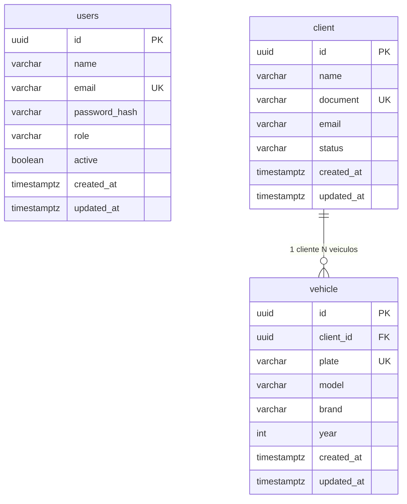
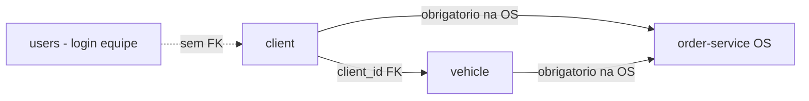

# identity-service

Microsserviço de identidade: autenticação (JWT), clientes e veículos.

## Banco de dados

PostgreSQL — database **`identity`**.





| Tabela | Papel | Relação |
|---|---|---|
| `users` | Login da equipe (JWT) | Isolada |
| `client` | Cliente da oficina | 1 → N `vehicle` |
| `vehicle` | Veículo | `client_id → client.id` |

Regra de negócio: OS (outro serviço) não existe sem cliente e veículo. Um cliente pode ter vários carros.

## Filas

Ainda **não**. O identity responde por HTTP (`auth`, cliente/veículo get-or-create). Não sobe LocalStack.

Lab completo (4 MS + rede `oficina-net`): [`../README.md`](../README.md).

```bash
docker network create oficina-net 2>/dev/null || true   # opcional aqui; os outros MS exigem
docker compose up -d          # identity :3001, postgres :5433
```


## CI/CD (AWS)

Deploy em **EKS** (sem Kind).

| Workflow | Quando | O que faz |
|---|---|---|
| `CI — identity-service` | push/PR | unit + integração + build |
| `Publish ECR — identity-service` | push `main` | push ECR + dispara deploy no `infra-kubernetes` |

Detalhes: [`infra/README.md`](infra/README.md).

## Observabilidade

Tudo que sai deste processo leva `service=identity-service` (logs Pino, eventos NR, labels do agente, `/health`).

Filtro NRQL / Fluent Bit:

```text
service = 'identity-service'
```

App name no New Relic: `identity-service` (`NEW_RELIC_APP_NAME` / labels `service:identity-service;component:identity`).
