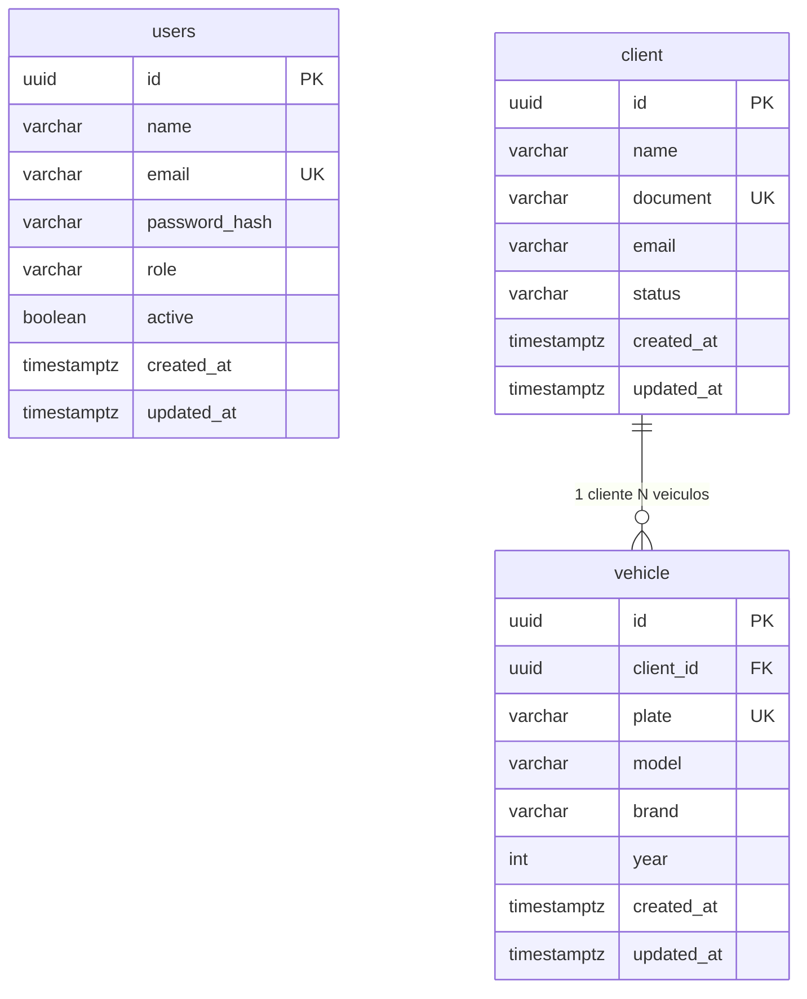
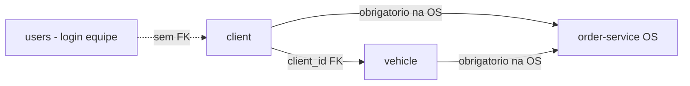

# identity-service

Microsserviço de identidade: autenticação (JWT), clientes e veículos.

## Banco de dados

PostgreSQL — database **`identity`**.





| Tabela | Papel | Relação |
|---|---|---|
| `users` | Login da equipe (JWT) | Isolada |
| `client` | Cliente da oficina | 1 → N `vehicle` |
| `vehicle` | Veículo | `client_id → client.id` |

Regra de negócio: OS (outro serviço) não existe sem cliente e veículo. Um cliente pode ter vários carros.

## Filas

Ainda **não**. O serviço responde por HTTP.

Na Saga (order ↔ identity), a ideia futura é fila *ensure/get-or-create* de cliente e veículo — ainda não implementado.

## CI/CD

| Workflow | Quando | O que faz |
|---|---|---|
| `CI — identity-service` | push/PR | unit + integração (DB `identity`) + build; artifact `identity-service-coverage` |
| `CD — identity-service (Kind)` | manual | lab Kind com manifests `k8s/identity-*` + smoke `/health` |
| `Publish ECR — identity-service` | push `main` | push `identity-service` + `identity-service-migrations` no ECR e dispatch no `infra-kubernetes` |

## Observabilidade

Tudo que sai deste processo leva `service=identity-service` (logs Pino, eventos NR, labels do agente, `/health`).

Filtro NRQL / Fluent Bit:

```text
service = 'identity-service'
```

App name no New Relic: `identity-service` (`NEW_RELIC_APP_NAME` / labels `service:identity-service;component:identity`).
